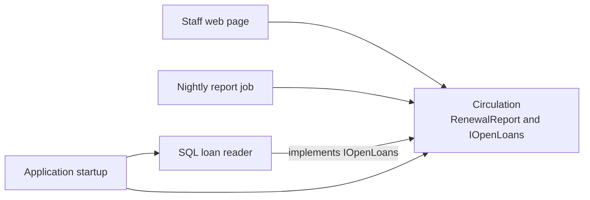

<!-- Generated from guides/patterns/ by dev/sync-plugin-guides.ps1. -->

# Solution-wide design patterns for Awl findings

Organize a solution around capabilities and the decisions they own. A circulation module owns the meaning of a library loan. Reporting which loans can be renewed is one use case within it. For an application released as one unit, a **modular monolith** is a good starting point. A capability can start as a namespace and become a project when a compiler-enforced dependency boundary is worth having. The practical question is which code must change together the next time a requirement changes. [Parnas, On the Criteria To Be Used in Decomposing Systems into Modules](https://john.cs.olemiss.edu/~hcc/csci555/notes/localcopy/Parnas_Criteria_Decomposing.pdf) · [Shopify’s modular monolith](https://shopify.engineering/deconstructing-monolith-designing-software-maximizes-developer-productivity)

## Four design choices

| Pattern | How it shapes the solution | Awl findings that can point to it |
| --- | --- | --- |
| **Capability modules and vertical slices** | Give a use case one public entry point. Keep its decisions, types and behavior tests together. If changing a renewal rule repeatedly touches unrelated services or both the web and batch projects, follow those edits to the missing owner. | `god-class`, `disjoint-collaborators`, `temporal-coupling`. [Bogard, Vertical Slice Architecture](https://www.jimmybogard.com/vertical-slice-architecture/) |
| **Ports and adapters** | Keep project dependencies acyclic. A capability defines the operations it needs in its own terms, an adapter implements them, and startup wires the two. A shared identifier can have wide fan-in. A database row used by every feature makes a storage migration everybody’s problem. | `wide-fan-in`, `namespace-cycle`, `layer-guard`, `coupling-between-objects`. [Cockburn, Hexagonal Architecture](https://alistair.cockburn.us/hexagonal-architecture) · [Seemann, Composition Root](https://blog.ploeh.dk/2011/07/28/CompositionRoot/) |
| **Functional core, imperative shell** | Give each business decision one owner that takes facts and returns an outcome. An application operation obtains the facts and carries out the effects. Entry points can present different responses to the same decision. Two similar calculations with independently owned promises can still change separately. | `foreign-data-access`, `semantic-duplicate-body`, `class-cognitive-complexity`. [Bernhardt, Boundaries](https://www.destroyallsoftware.com/talks/boundaries) |
| **Explicit ownership of work and state** | The request or job owns completion, cancellation and failure. It can load a batch or build an index once for the consumers of the same snapshot. Shared work that outlives a request needs a longer-lived owner. Decide which version each consumer is entitled to see before sharing results. | `repeated-external-effect`, `repeated-work`, `mutable-static-field`, `unawaited-task`, `unforwarded-cancellation-token`. [Smith, Notes on structured concurrency](https://vorpus.org/blog/notes-on-structured-concurrency-or-go-statement-considered-harmful/) |

## One policy used by a web page and a nightly job

Suppose the staff page reads loans from SQL and decides which can be renewed. A nightly report repeats that calculation and loads holds one loan at a time. Raising the renewal limit now requires two policy edits. Changing the hold schema affects both entry points. Extracting shorter methods in each project would preserve both problems.

Give the circulation module the renewal report. The arrows below are compile-time dependencies. At runtime, startup supplies the SQL reader to the report, and both callers invoke the same operation.



```csharp
// In Circulation. Loan IDs, facts and outcomes use the library's vocabulary.
public sealed record OpenLoan(LoanId Id, bool HasHold, int RenewalCount);

public interface IOpenLoans
{
    Task<IReadOnlyList<OpenLoan>> ForBranchAsync(BranchId branch, CancellationToken token);
}

public sealed class RenewalReport(IOpenLoans loans)
{
    private const int RenewalLimit = 2;

    public async Task<RenewalRow[]> ForBranchAsync(BranchId branch, CancellationToken token)
    {
        var snapshot = await loans.ForBranchAsync(branch, token);
        return snapshot.Select(loan => new RenewalRow(loan.Id, Decide(loan))).ToArray();
    }

    private static RenewalStatus Decide(OpenLoan loan)
    {
        if (loan.HasHold) return RenewalStatus.OnHold;
        return loan.RenewalCount >= RenewalLimit ? RenewalStatus.AtLimit : RenewalStatus.Eligible;
    }
}
```

The reader contract promises each open loan in the branch once, with its hold state from the same snapshot. The SQL adapter can fulfill it with a set-based query. A port that still issues one query per loan retains that cost. Startup supplies `new RenewalReport(new SqlOpenLoans(connectionFactory))` to each entry point.

```csharp
// In the web endpoint
Task<RenewalRow[]> GetAsync(BranchId branch, CancellationToken requestAborted) =>
    report.ForBranchAsync(branch, requestAborted);

// In the nightly job
async Task RunAsync(BranchId branch, CancellationToken stoppingToken)
{
    var rows = await report.ForBranchAsync(branch, stoppingToken);
    await publisher.PublishAsync(rows, stoppingToken);
}
```

Both callers can depend on `RenewalStatus`. Its fan-in records their agreement on what “at limit” means. If changing the SQL representation of a hold forces both callers to change, a storage detail has escaped the adapter.

| Next requirement | Where the edit belongs | Behavior that demonstrates the boundary |
| --- | --- | --- |
| Raise the renewal limit | Circulation’s decision and its boundary examples | A loan at the old limit with no hold becomes eligible in both outputs. A held loan still reports `OnHold`. |
| Move holds into a different table | The SQL reader and its adapter test | The same branch still yields the same loan IDs and hold states, including loans with multiple holds. |
| Add a CSV export | A formatter using the existing report and its entry-point wiring | CSV can change its columns while the reported renewal statuses continue to agree with the staff page. |

If the nightly job later chooses **whom to remind**, that is a second decision. Let it consume renewal status and apply its own notification preferences. Adding a `forNightlyJob` switch to eligibility would make a messaging change affect circulation policy.

## The same choices in Awl

`wide-fan-in` illustrates three independent reasons to edit the solution.

| Requested change | Owner |
| --- | --- |
| Change which source declarations count as distinct consumers | The versioned semantic fan-in query owns the counting definition. The rule consumes its evidence and produces neutral assessments for the entry points. SourceFanIn (`src/Awl.Semantics/Dependencies/SourceFanIn.cs`) · WideFanInRule (`src/Awl.Rules/Design/WideFanInRule.cs`) |
| Deny a hook edit at a different count while keeping the same reporting severity | The hook’s configured breakpoint owns that choice. An existing compatible assessment can be classified under the new profile. Rule execution and profile identity (`docs/rule-execution.md#policy-identity`) |
| Change how an existing finding is displayed in SARIF | The reporting adapter owns the rendering of the result contract. A change to how the count is displayed has no reason to redefine a consumer. Reporting contract (`docs/reporting.md`) · Reporting project references (`src/Awl.Reporting/Awl.Reporting.csproj`) |

Use a real change from history to decide whether a finding calls for architecture work. If the same policy edit repeatedly crosses projects, or several entry points rebuild the same expensive facts, draw a boundary around that decision or work. If a single handler loses an exception’s cause and its caller already has the right contract, repair the handler there. Awl’s own plan uses this test of changeability for its module boundaries. Awl’s module boundaries and changeability (`docs/implementation-plan.md#module-boundaries-and-changeability`) · [Patterns by rule](README.md)
